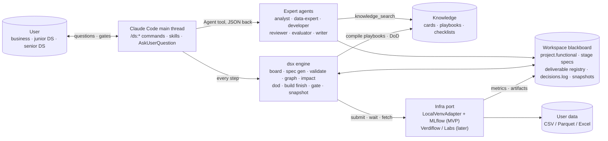
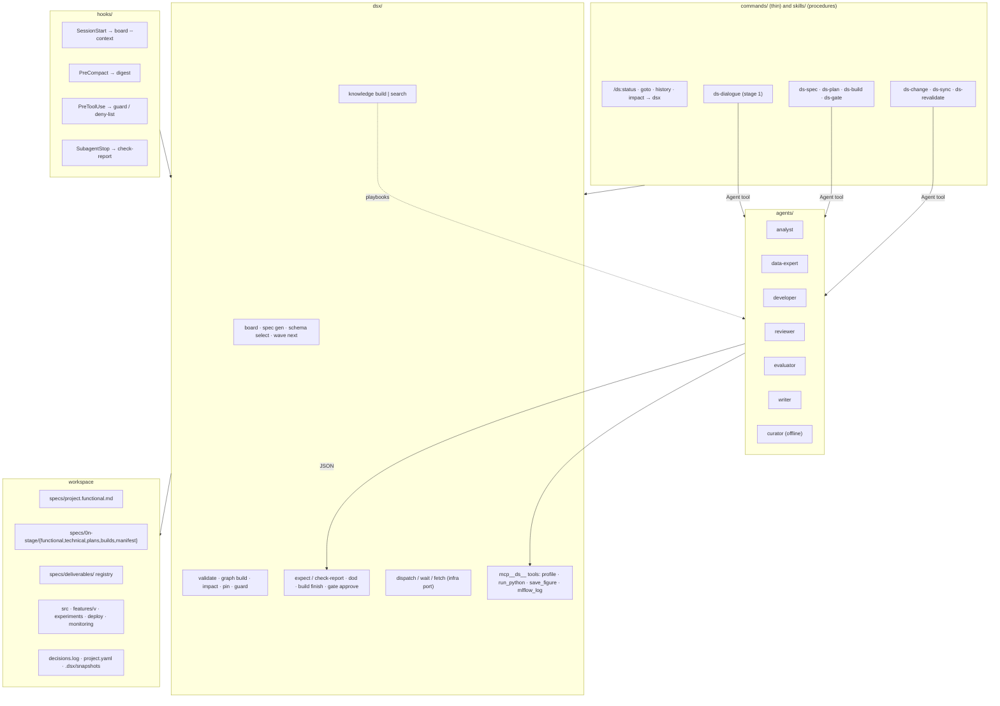
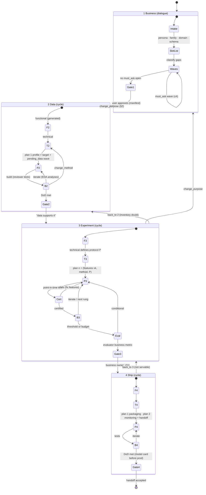
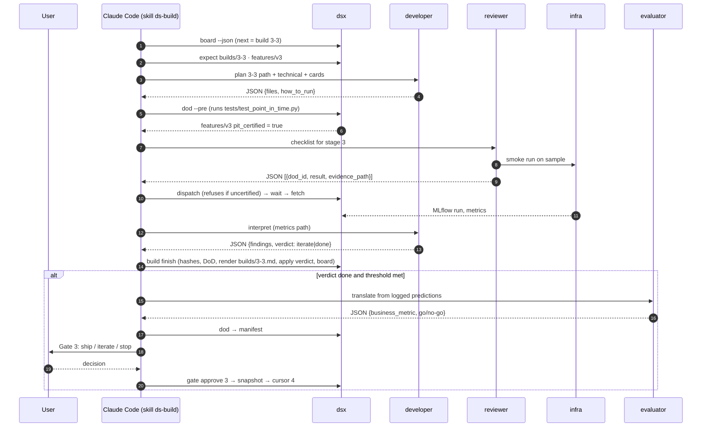
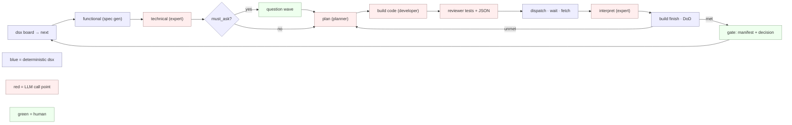

# ds-expert-agent — Architecture diagrams (v0.4, four stages)

Render: GitHub, VS Code (Markdown Preview Mermaid), Obsidian, or `npx @mermaid-js/mermaid-cli -i docs/ARCHITECTURE-DIAGRAMS.md -o docs/img/x.md -e png`.

## 0. Name of the architecture

**A spec-driven, stage-gated agentic workflow over a blackboard, with an orchestrator–workers panel of experts and evaluator–optimizer loops, built on ports-and-adapters** (short: *stage-gated blackboard orchestrator*).

| Layer | Pattern | Here |
|---|---|---|
| Control flow | agentic workflow (predefined code paths with LLM steps) + Stage-Gate | 4 stages; `dsx` decides the next step; the LLM runs at call points; every stage exits through a gate that certifies evidence |
| Collaboration | orchestrator–workers (supervisor) | Claude Code main thread owns the conversation; 6 stateless expert agents |
| Quality | evaluator–optimizer | developer → reviewer tests; independent evaluator at the Experiment exit |
| Shared state | blackboard | specs, deliverable registry, decisions.log, snapshots on disk |
| Boundaries | ports and adapters + human-in-the-loop | infra port (local venv now), UI (Claude Code now), knowledge store |

## 1. System context

## 2. Components mapped to plugin primitives

## 3. Lifecycle: four stages, three human gates

## 4. One Experiment iteration (sequence)

## 5. Call points: code vs LLM vs human

## 6. MVP scope

| Component | MVP | Later |
|---|---|---|
| Surface | Claude Code plugin | Agent SDK app, web |
| Infra port | LocalVenvAdapter + MLflow file store | Verdiflow / Labs |
| Staleness | stage-level with cost; section-level for the project functional | section-level everywhere, LLM revalidation, branches |
| Agents | 6 + curator | domain packs add cards, not agents |
| Deployment | FastAPI + Docker + MLflow registry, tests locally | registry push, cloud run |
